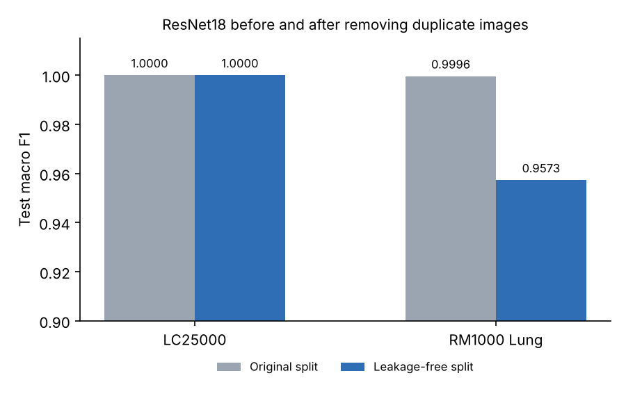
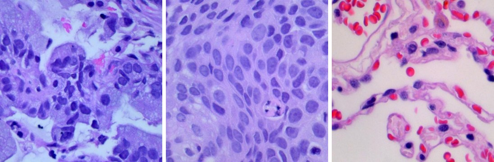
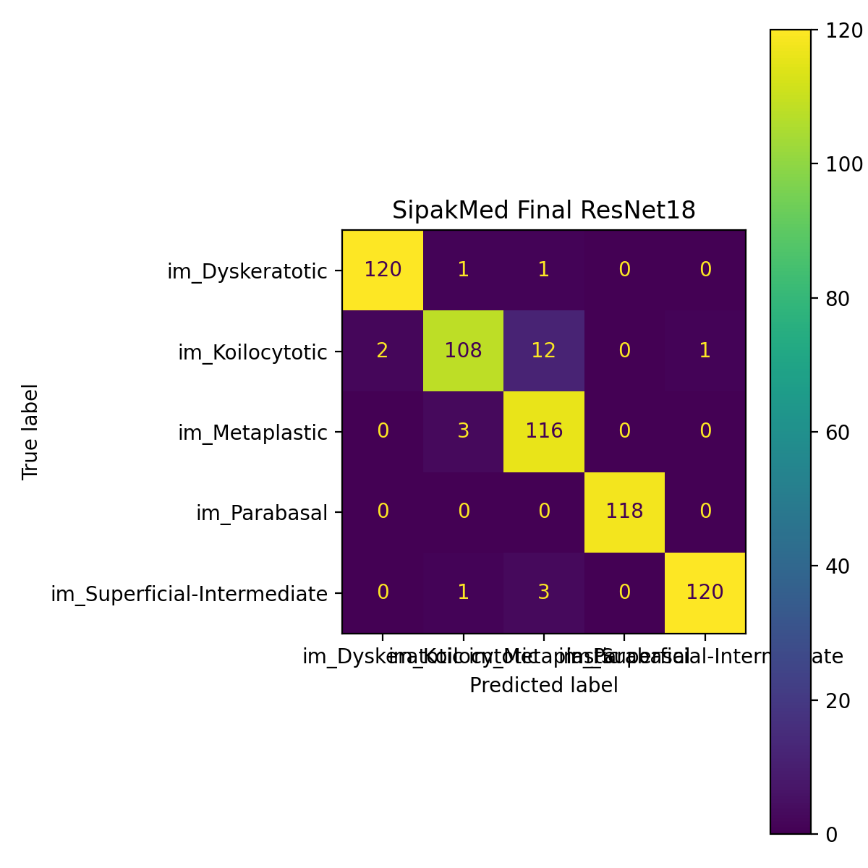

# Cancer Platform

Reproducible machine learning pipeline for evaluating classical machine learning and deep learning models on heterogeneous oncology datasets.

This project was developed as part of my bachelor thesis:

**Evaluation and Comparison of Machine Learning Models on Heterogeneous Oncology Datasets**

The focus of the project is not only on achieving high classification metrics, but also on building a transparent and reproducible workflow that includes data preparation, quality control, data leakage detection, model training and evaluation.

---

## Results

| Dataset | Scenario | Model | Test Accuracy | Test Macro F1 |
|---|---|---|---:|---:|
| Thyroid Recurrence | Baseline | Random Forest | 0.9818 | 0.9775 |
| SIPaKMeD | Final model | ResNet18 | 0.9604 | 0.9606 |
| LC25000 | Leakage-free split | ResNet18 | 1.0000 | 1.0000 |
| RM1000 Lung | Leakage-free split | ResNet18 | 0.9573 | 0.9573 |

The most important finding was on RM1000. With the original split ResNet18 got a macro F1 of 0.9996, which looked almost perfect. After I checked the images with MD5 hashes, it turned out that some identical images were in both the train and the test set. On a leakage-free split the score dropped to 0.9573, which is a much more realistic number.



LC25000 stayed at 1.0 even after the leakage-free split. This is not a bug. The two classes (lung vs. colon tissue) are very easy to tell apart, so the dataset is close to trivially separable and the high score is not caused only by duplicates.

---

## Thesis Abstract

*The thesis itself is written in Serbian. This is a short English summary.*

The subject of the thesis is the application of machine learning methods to medical data related to cancer, with a focus on a practical, reproducible and clearly documented workflow. Four public Kaggle datasets were used, covering both histopathology images (SIPaKMeD, LC25000, RM1000 Lung) and tabular clinical data (Thyroid Recurrence). The work covers the full process: dataset analysis, data preparation and standardization, training and comparison of several models, and presenting the results through relevant metrics and visualizations.

Classical models (Logistic Regression, Random Forest) were used for the tabular data, and transfer learning with ResNet18 for the image data. Result stability was checked with multiple random seeds and 5-fold cross-validation, and the image data was checked for quality issues and for leakage between splits using MD5 hashes.

The leakage check turned out to be the key step. On RM1000 the baseline reached a macro F1 of 0.9996, but on a leakage-free split it dropped to a more realistic 0.9573. LC25000 stayed at 1.0 even after the leakage-free split, which suggests the dataset is close to trivially separable and the high scores are not caused only by duplicates. The final SIPaKMeD model (ResNet18 with early stopping) reached a test macro F1 of 0.9606.

The full thesis (in Serbian) is in [docs/thesis_sr.pdf](docs/thesis_sr.pdf).

---

## Project Motivation

Machine learning methods are increasingly used in medical data analysis, especially for image-based and tabular diagnostic support systems.

However, high accuracy alone is not enough in medical machine learning. The reliability of the results depends heavily on:

- how the data is prepared,
- whether there is data leakage between training and test sets,
- how stable the model results are,
- whether the full experiment can be reproduced.

This project explores these issues using multiple public oncology datasets.

---

## Datasets

The project uses four publicly available Kaggle datasets:

| Dataset | Type | Task | Samples Used |
|---|---|---|---:|
| SIPaKMeD | Histopathology images | Cervical cell classification | 4,049 cropped images |
| LC25000 | Histopathology images | Lung / colon tissue classification | 25,000 images |
| RM1000 Lung | Histopathology images | Lung tissue classification | 15,000 images |
| Thyroid Recurrence | Tabular clinical data | Recurrence prediction | 364 cleaned rows |

Example images from RM1000 Lung:



Dataset sources:

1. SIPaKMeD Cervical Cancer Dataset  
   https://www.kaggle.com/datasets/prahladmehandiratta/cervical-cancer-largest-dataset-sipakmed

2. Lung and Colon Cancer Histopathological Images  
   https://www.kaggle.com/datasets/andrewmvd/lung-and-colon-cancer-histopathological-images

3. Lung Cancer Histopathological Images  
   https://www.kaggle.com/datasets/rm1000/lung-cancer-histopathological-images

4. Differentiated Thyroid Cancer Recurrence  
   https://www.kaggle.com/datasets/joebeachcapital/differentiated-thyroid-cancer-recurrence

The datasets are not part of this repository and each one keeps the license from its Kaggle page.

---

## Pipeline Overview

The full workflow follows these steps:

```text
Raw data
    ↓
Data preparation and standardization
    ↓
Stratified train / validation / test split
    ↓
Baseline model training
    ↓
Stability experiments
    ↓
Quality control and leakage detection
    ↓
Leakage-free split generation
    ↓
Final model evaluation
    ↓
Result registry and reporting
```

---

## Main Features

- Reproducible train / validation / test split using a fixed random seed.
- Stratified splitting to preserve class distribution across splits.
- Classical machine learning baselines for tabular medical data.
- Transfer learning with ResNet18 for histopathology image classification.
- Image quality control using blur and brightness checks.
- Exact duplicate leakage detection using MD5 hashes.
- Leakage-free split generation for datasets with duplicate overlap.
- Final result registry and saved experiment artifacts.

---

## Models Used

### Tabular Data

For the Thyroid Recurrence dataset:

- Logistic Regression
- Random Forest

### Image Data

For histopathology image datasets:

- ResNet18
- Transfer learning
- CNN-based classification

---

## Evaluation Metrics

The models are evaluated using:

- Accuracy
- Macro F1-score
- Confusion matrix
- Stability across multiple random seeds
- Cross-validation for the tabular dataset

Macro F1-score is especially important because it evaluates performance across all classes equally, which is useful when class distributions are not perfectly balanced.

Confusion matrix for the final SIPaKMeD model. Most of the mistakes are between Dyskeratotic, Koilocytotic and Metaplastic cells, which also look similar under the microscope:



---

## Data Leakage Detection

Data leakage was checked by comparing MD5 hash values of images across train, validation and test splits.

This allowed detection of exact duplicate images that appeared in different splits. In a sample of 5,000 train and 2,000 test images, RM1000 had 84 hashes that showed up on both sides and LC25000 had 41. SIPaKMeD had none.

For datasets where leakage was detected, new leakage-free splits were generated by grouping images with the same MD5 hash and ensuring that identical images could not appear in different splits.

This step was especially important because very high model performance can sometimes be caused by duplicate or near-duplicate samples appearing across different splits.

---

## Limitations

- The Thyroid Recurrence dataset is small (364 rows, 55 in the test set), so its results can change a lot with a different split.
- The leakage check only finds exact duplicates. Images that are almost the same (cropped, rotated, recompressed) are not detected by MD5.
- Image models were trained only with ResNet18 and a small number of epochs, because of limited GPU time on Colab.
- All results come from a single held-out test set per dataset, without external validation on data from another source.

---

## How to Use

### 1. Clone the repository and install dependencies

```bash
git clone https://github.com/Milki19/cancer-platform.git
cd cancer-platform
pip install -r requirements.txt
```

### 2. Set up Kaggle API access

1. Create a Kaggle account.
2. Go to Account settings and create a new API token.
3. Place the `kaggle.json` file in the appropriate local directory.

Typical Windows path:

```text
C:\Users\<your-username>\.kaggle\kaggle.json
```

Typical Linux / Colab path:

```text
~/.kaggle/kaggle.json
```

You can check whether Kaggle API is available with:

```bash
kaggle --version
```

### 3. Download the datasets

Download all datasets:

```bash
python scripts/download_kaggle_data.py
```

Download only one dataset:

```bash
python scripts/download_kaggle_data.py --dataset sipakmed
```

Available dataset names:

```text
sipakmed
lc25000
rm1000_lung
thyroid_recurrence
```

If the dataset folder already contains files and you want to download again, add `--force`:

```bash
python scripts/download_kaggle_data.py --dataset sipakmed --force
```

Downloaded datasets will be stored locally under `Data/raw/`. The `Data/` directory is ignored by Git and should not be committed.

### 4. Verify downloaded raw data

After downloading the datasets, run the raw data scanner to check whether the expected files and folders exist:

```bash
python src/scan_raw.py
```

or for one dataset:

```bash
python src/scan_raw.py --dataset thyroid_recurrence
```

For image datasets, the scanner reports the number of image files, file extensions, detected class folders, class counts and dataset size. For the tabular dataset, it reports the detected CSV / Excel file, table shape and column names.

The scan summary is saved locally to `artifacts/reports/`, for example:

```text
artifacts/reports/scan_raw_summary.json
artifacts/reports/scan_raw_summary_thyroid_recurrence.json
```

If some datasets have not been downloaded yet, the scanner will report them as `MISSING`. This is expected and does not indicate a problem with the repository.

### 5. Run the notebooks

The notebooks in `notebooks/` are numbered in the order they should be run (01 → 07). See [notebooks/README.md](notebooks/README.md) for what each one does.

The experiments were originally run on Google Colab (L4 / T4 GPU) with the data on Google Drive. When a notebook runs on Colab it mounts Drive and uses `/content/drive/MyDrive/Diplomski` as the root folder. When it runs locally, the root folder is the repository itself, so start Jupyter from the repository and open the notebooks from `notebooks/`.

The raw datasets and large experiment artifacts are not included in the repository because of their size. They can be regenerated by running the workflow above.

---

## Repository Structure

```text
cancer-platform/
│
├── configs/
│   └── datasets.yaml
│
├── docs/
│   ├── images/               # figures used in this README
│   ├── thesis_sr.pdf         # full thesis (Serbian)
│   └── ...                   # thesis source and defense presentation (Serbian)
│
├── notebooks/                # main experimental workflow, 01 → 07
│   ├── 01_data_prep.ipynb
│   ├── 02_data_and_baselines.ipynb
│   ├── 03_experiments_stability.ipynb
│   ├── 04_qc_and_leakage.ipynb
│   ├── 05_leakage_free_split.ipynb
│   ├── 06_rerun_baseline_v2.ipynb
│   ├── 07_final_registry_and_models.ipynb
│   └── README.md
│
├── scripts/
│   └── download_kaggle_data.py
│
├── src/
│   └── scan_raw.py
│
├── LICENSE
├── README.md
├── requirements.txt
└── .gitignore
```

Recommended local data structure:

```text
Data/
├── raw/
├── curated/
├── curated_qc/
└── curated_v2/
```

---

## Reproducibility

The experiments were designed to be reproducible by saving:

- fixed random seeds,
- train / validation / test CSV files,
- metadata files,
- model metrics,
- confusion matrices,
- experiment summaries,
- dataset registry files.

The main seed used throughout the project is:

```text
seed = 42
```

---

## Future Work

Possible extensions of this project include:

- Grad-CAM visualization for CNN interpretability,
- SHAP analysis for tabular models,
- ROC-AUC and confidence intervals,
- near-duplicate detection (for example with perceptual hashing) in addition to MD5,
- external validation on additional medical datasets,
- stronger experiment tracking,
- comparison with more advanced architectures such as EfficientNet or Vision Transformers.

---

## License

The code in this repository is released under the [MIT License](LICENSE). The datasets are not included and keep their original Kaggle licenses.

---

## Author

**Stefan Milić**  
Bachelor thesis project  
Faculty of Computing, Union University  
Belgrade, 2026
